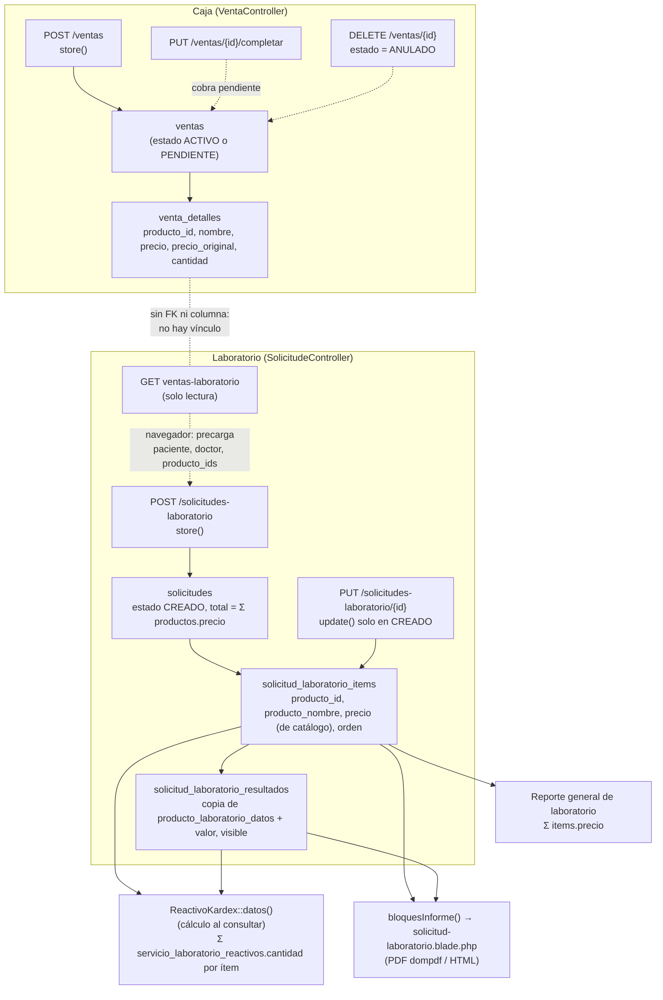

# Perfiles de exámenes — Fase 0: diagnóstico del flujo actual

Fecha: 2026-11-10. Solo lectura: no se modificó código ni datos.

**Código analizado:** `master` (`3902295`). Todas las líneas citadas corresponden a esa versión.

**Datos consultados.** BD local `back` y BD de pruebas `urme_prueba`, solo con `SELECT` sobre el catálogo y conteos. **No son producción**: los conteos de producción quedan pendientes (ver §7).

Convención: `[Inferido]` = no confirmado directamente en el código.

---

## Resumen

1. **Venta y solicitud no están vinculadas.**
   - No hay `venta_id` en `solicitudes` ni `solicitud_id` en `ventas`.
   - "Cargar venta pagada" solo precarga el formulario en el navegador, y la venta no queda marcada como usada.
   - Anular la venta no toca la solicitud, y eliminar la solicitud no toca la venta.
2. **La solicitud no usa el precio cobrado en la venta.** Cada ítem copia `productos.precio` vigente al guardar, y lo vuelve a copiar en cada edición.
3. **El kardex de reactivos no descuenta nada.**
   - Es un reporte que se calcula al consultarlo, sobre `solicitud_laboratorio_items.producto_id`.
   - Cuenta los ítems con algún resultado escrito, o de solicitudes `ANALIZADO`/`FINALIZADO`.
   - Ningún endpoint cambia el estado: todas las solicitudes quedan en `CREADO`.
4. **Hoy no se puede repetir un examen en una solicitud.**
   - La validación usa `distinct`.
   - El frontend y `syncLaboratorios` indexan por `producto_id` y por `producto_laboratorio_dato_id`.
   - Al expandir un perfil, deduplicar es **obligatorio**, no opcional.
5. **No existe ningún concepto de paquete, combo, kit o producto compuesto.**
   - "PERFIL CARDIACO", "PERFIL TIROIDEO" e "IONOGRAMA / ELECTROLITOS" son **áreas** (`tipo_productos`), no productos.
   - Lo más parecido a un perfil es `grupo_reporte`: Sodio, Potasio y Cloro se imprimen juntos bajo "ELECTROLITOS". Es solo presentación y no tiene precio propio.
6. **Las soft deletes anulan el `ON DELETE RESTRICT` propuesto.** `productos` usa `SoftDeletes`, así que el borrado nunca llega a la FK.

---

## Decisiones (2026-11-10)

Tomadas tras revisar esta fase. Prevalecen sobre las sugerencias de §10 donde difieran.

1. **Precio del perfil.**
   - Tabla nueva `solicitud_laboratorio_perfiles` con el nombre y el precio del perfil.
   - Los exámenes del perfil se guardan en `solicitud_laboratorio_items` con **precio 0**.
2. **Sin congelamiento especial.** Mientras la solicitud está en `CREADO`, cada edición vuelve a expandir el perfil desde el catálogo. Es lo mismo que hace hoy `syncLaboratorios` con los exámenes (§2.5).
3. **Perfil más un examen suelto que ya incluye:**
   - al agregar el perfil, se quita el suelto **con aviso**;
   - no se puede agregar suelto un examen ya incluido en un perfil de la solicitud.
4. **Dos perfiles que comparten un examen:** se permite, **con aviso**. El examen aparece una sola vez, en el **primer** perfil según el orden de la solicitud.
5. **Bajas.**
   - No se puede dar de baja un examen que forma parte de un perfil activo.
   - Un perfil con algún examen inactivo no se puede vender.
6. **Reportes.** El perfil aparece con su precio. Sus exámenes aparecen como "incluido en el perfil".
7. **Vínculo venta–solicitud: fuera de este proyecto.**
   - Queda como pendiente propio, de prioridad alta, en [`PENDIENTES.md`](PENDIENTES.md).
   - Cubre tres problemas: la venta pagada se puede cargar varias veces, anular la venta no afecta a la solicitud, y el precio se toma del catálogo en lugar del cobrado.
   - Mientras tanto, siguen vigentes los riesgos 1, 2, 4 y 12 de §9.
8. **No se quitan exámenes de un perfil dentro de una solicitud.** Se pone o se quita el perfil entero (pregunta 3).
9. **`precio_seguro`:** igual que en cualquier producto, sin trabajo extra (pregunta 6).
10. **Informe:**
    - un bloque por perfil, con su título;
    - una fila "ÁREA DE …" cada vez que cambia el área (pregunta 7).
11. **Dentro de un perfil manda el perfil.** `grupo_reporte` aplica solo a los exámenes sueltos (pregunta 8).
12. **Catálogo inicial:** los perfiles los crea el personal desde la pantalla, sin migración de datos (pregunta 9).
13. **Cantidad > 1** de un perfil o examen en la venta:
    - se avisa, sin bloquear;
    - en la solicitud, el perfil se expande una sola vez (pregunta 10).
14. **Definición de inactivo** (para la decisión 5). Un examen no es vendible dentro de un perfil si:
    - está dado de baja (soft delete), o
    - su área deja de ser de laboratorio (`tipo_productos.es_laboratorio = 0`, o el producto queda sin área).

---

## Estado del proyecto

| Fase | Alcance | Estado |
|---|---|---|
| 0 | Diagnóstico y decisiones (este documento) | Hecha (2026-11-10) |
| 1 | Modelo y catálogo de perfiles | Implementada en `master` (2026-11-11), con el interruptor apagado |
| 2 y siguientes | Venta, solicitud (expansión), kardex, informe y reportes | Pendientes |

### Fase 1: modelo y catálogo

**Interruptor.**
- `LAB_PERFILES_HABILITADO` (en `back/.env`, por defecto `false`) se lee en `config('laboratorio.perfiles_habilitado')`.
- Llega al frontend en `GET /me` y `POST /login`, como `configuracion.lab_perfiles_habilitado`, y se guarda en el store (`perfilesLaboratorio`).
- Con `false`:
  - el catálogo se ve como antes;
  - `PUT /productos/{id}/laboratorio-perfil` responde 404;
  - `laboratorio-configuracion` no trae el bloque `perfil`;
  - los perfiles no se listan ni se cuentan en las áreas.

**Base de datos.** Dos migraciones de esquema, aditivas:
- `2026_11_11_000100_add_es_perfil_to_productos_table`;
- `2026_11_11_000200_create_producto_perfil_items_table`, con borrado físico de filas y el modelo `ProductoPerfilItem` auditable.

**Reglas,** en `ProductoLaboratorioController::updatePerfil` y en el modelo `Producto`:
- el perfil debe ser de laboratorio y tener al menos 2 exámenes;
- los exámenes deben estar activos (decisión 14), ser de laboratorio, sin repetir y no ser perfiles;
- un perfil no admite parámetros, fórmulas, validaciones ni reactivos propios;
- no se marca como perfil un producto que ya los tiene, ni uno que forma parte de un perfil;
- un perfil no puede cambiarse a un área que no sea de laboratorio;
- **no se puede dar de baja un examen que forma parte de un perfil vigente**, aunque el interruptor esté en `false`. Es un hook `deleting` del modelo, así que rige por cualquier camino de baja;
- dar de baja el perfil no toca sus exámenes.

**Vendible.** `Producto::esPerfilVendible()` se cumple si el perfil está vigente, en un área de laboratorio, y tiene ≥ 2 exámenes, todos activos. Lo usará la Fase 2.

**Fuera de la venta hasta la Fase 2,** aun con el interruptor en `true`:
- `GET /productos` excluye los perfiles, salvo el catálogo de laboratorio con `incluir_perfiles=1`;
- también los excluyen `solicitudes-laboratorio/form-data` y `reactivos/form-data`;
- `POST /ventas` y `POST/PUT /solicitudes-laboratorio` rechazan un perfil con 422.

**Pantalla.**
- En `laboratorio/[id].vue`: selector "Tipo: Examen / Perfil" y sección "Exámenes del perfil", con buscador, lista ordenable y botón para quitar, más la suma de precios sueltos frente al precio del perfil.
- En `laboratorio/index.vue`: chip "PERFIL" y filtro "Tipo".

**Tests.** `tests/Feature/PerfilLaboratorioTest.php` tiene 16 casos sobre un esquema propio en SQLite, sin depender de las migraciones que fallan.

---

## 1. Diagrama del flujo actual



Versión en texto:

```
Nueva venta ─► ventas ─► venta_detalles            (caja, cierre, dashboard)
                              ┊ (sin vínculo en BD)
"Cargar venta pagada" ┄┄ lee ventas ┄┄► formulario en el navegador
Crear laboratorio ─► solicitudes ─► items ─► resultados ─► informe PDF/HTML
                                       └──► kardex de reactivos (cálculo al consultar)
                                       └──► reporte general de laboratorio (Σ precio)
```

---

## 2. De la venta a la solicitud

### 2.1 Los tres caminos

**a) "Nueva venta"** (`front/src/pages/index/ventas/crear.vue`)

- `POST /ventas` → `VentaController::store` (`master`, `back/app/Http/Controllers/VentaController.php:196-324`).
- Orden de escritura:
  1. `Venta::create` con `total = 0` (`:228-243`);
  2. por cada línea, un `VentaDetalle::create` (`:290-302`);
  3. `venta->update(total, total_original, montos de pago)` (`:305-315`).
- **No crea solicitud ni ítems.** No hay ninguna llamada a `Solicitude` en `VentaController`.

**b) "Crear laboratorio"** (`front/src/pages/index/solicitudes-laboratorio/nueva.vue`)

- `POST /solicitudes-laboratorio` → `SolicitudeController::store` (`back/app/Http/Controllers/SolicitudeController.php:131-152`).
- Orden de escritura:
  1. `validatedPayload()` (`:350-393`) carga los `Producto` de laboratorio, en el orden de `producto_ids`;
  2. `Solicitude::create` con `estado = CREADO` y `total = Σ producto.precio` (`:137-142`);
  3. `update(codigo_solicitud = LAB-Ymd-#####)` (`:143-145`);
  4. `syncLaboratorios()` (`:482-528`) crea un `SolicitudLaboratorioItem` por producto, con nombre y precio copiados del catálogo y `orden = (i+1)*10`;
  5. por cada `producto_laboratorio_datos` del producto, crea un `SolicitudLaboratorioResultado` con la metadata copiada y el `valor`/`visible` enviados.
- **No crea ni lee ninguna venta.**

**c) "Cargar venta pagada"** (botón en `nueva.vue:13-14`, solo al crear)

1. `GET /solicitudes-laboratorio/ventas-laboratorio` → `SolicitudeController::ventasLaboratorio` (`:87-129`). Es solo lectura y devuelve:
   - ventas con paciente;
   - en estado `ACTIVO`, o `PENDIENTE` ya cobradas;
   - con al menos un detalle de laboratorio, y solo esos detalles.
2. Al elegir una, `aplicarVentaLaboratorio()` (`nueva.vue:590-619`) **solo rellena el formulario**:
   - `paciente_id` y `doctor_id`;
   - `producto_ids` = los `producto_id` únicos de los detalles que existen en el catálogo cargado (`new Set`, `:592-594`).
3. Después se guarda por el camino **(b)**. El payload no lleva `venta_id` (`nueva.vue:824-830`; `validatedPayload` no lo acepta).

Consecuencias del camino (c):

- La misma venta puede cargarse en varias solicitudes; nada lo impide.
- El precio cobrado (`venta_detalles.precio`, con descuento manual) **no** pasa a la solicitud: se usa `productos.precio` (`SolicitudeController.php:141, 490`).
- Si el cajero vendió 2 unidades del mismo examen, la solicitud lleva 1 (dedupe del `Set`).
- Un producto de la venta borrado del catálogo (soft delete) se omite sin aviso: `formData` no lo trae (`:63-67`) y el filtro `idsDisponibles` lo descarta (`nueva.vue:591`).
- Los cobros de internación generan detalles con `producto_id = null` (`back/app/Services/CobroInternacion.php:63-67`), así que nunca aparecen en "Cargar venta pagada".

### 2.2 Transacciones

| Operación | ¿Transacción? | Referencia |
|---|---|---|
| `VentaController::store` | Sí, con `lockForUpdate` sobre el lote de farmacia | `VentaController.php:227, 267-269` (`master`) |
| `VentaController::completar` | Sí | `:402` |
| `VentaController::destroy` (anular) | No (un solo `update`) | `:431-443` |
| `SolicitudeController::store` | Sí: solicitud, ítems y resultados | `SolicitudeController.php:136-149` |
| `SolicitudeController::update` | Sí | `:167-173` |
| `SolicitudeController::destroy` | No (un solo soft delete) | `:337-344` |

Venta y solicitud nunca comparten una transacción: son dos peticiones HTTP independientes.

### 2.3 Relación venta ↔ solicitud

**No existe.** Columnas de `solicitudes`, verificadas en `information_schema`:

- `paciente_id`, `doctor_id`, `user_id`;
- `codigo_solicitud`, `codigo_verificacion`, `codigo_laboratorio`;
- `fecha_solicitud`, `hora_solicitud`;
- `diagnostico_clinico`, `observaciones`;
- `estado`, `total`;
- timestamps y `deleted_at`.

No hay `venta_id`. `ventas` tampoco referencia solicitudes. `Solicitude` no define una relación con `Venta` (`back/app/Models/Solicitude.php:57-75`). El único dato compartido es el paciente, y el doctor si coincide.

- En la práctica, una venta puede originar **N** solicitudes (cargándola varias veces), y una solicitud puede armarse a mano con exámenes de varias ventas.
- **[Inferido]** El personal hoy concilia "venta pagada ↔ solicitud" a ojo, por paciente y fecha.

### 2.4 Anular la venta / eliminar la solicitud

- **Anular la venta** (`VentaController::destroy`, `:431-443`) solo pone `estado = ANULADO`. La solicitud no cambia: sigue con sus resultados, cuenta en el kardex y se imprime.
- **Eliminar la solicitud** (`SolicitudeController::destroy`, `:337-344`) exige el permiso `Eliminar Solicitudes Laboratorio` y `estado = CREADO`, y hace un **soft delete** solo de la cabecera.
  - Los ítems y resultados no se marcan como borrados: el `ON DELETE CASCADE` solo actúa en un borrado físico.
  - Quedan fuera de todas las consultas porque las relaciones `whereHas('solicitude')` excluyen al padre borrado. Lo aplican el kardex (`ReactivoKardex.php:19`) y el reporte general (`LaboratorioReporteController.php:61`).
  - La venta no cambia.
- En la BD no existe el estado `ANULADO` para solicitudes, aunque el kardex lo filtra (`ReactivoKardex.php:21`) y el dashboard también (`DashboardController.php:186`).

### 2.5 Editar una solicitud en `CREADO`

`update()` (`:161-176`) aborta si el estado no es `CREADO` y reutiliza `validatedPayload()` y `syncLaboratorios()`. `syncLaboratorios()` (`:482-528`) **no borra y recrea todo: reconcilia**.

- Indexa los ítems existentes por `producto_id` (`:484`).
  - Si el producto sigue, **actualiza** el ítem: `producto_nombre`, `precio` y `orden` se recopian del catálogo **actual** (`:487-495`).
  - Si es nuevo, lo crea.
- Dentro de cada ítem indexa los resultados por `producto_laboratorio_dato_id` (`:499`).
  - Si el dato existe, actualiza el resultado: nombre, unidad, método, muestra, referencia y fórmula se recopian del catálogo actual, junto con `valor` y `visible`.
  - Si no existe, lo crea.
  - Los resultados de datos que ya no existen en el producto se borran con soft delete (`:521`).
- Los ítems de productos quitados se borran con soft delete, junto con sus resultados (`:524-527`).

**Implicación:** hoy la solicitud **no está congelada**. Cada guardado vuelve a copiar el precio, el nombre y la metadata de los parámetros desde el catálogo. El precio de un ítem puede cambiar al editar si el arancel cambió entre medio. Esto afecta la decisión de "composición congelada" (§5).

### 2.6 El mismo examen dos veces

- **Venta:**
  - El frontend no crea una segunda línea: suma cantidad (`crear.vue:870-878`).
  - El backend sí aceptaría dos líneas iguales, porque no valida `distinct` (`VentaController.php:216-222`).
  - En las BD consultadas no hay casos: 0 ventas con el mismo examen en 2 líneas y 0 detalles de laboratorio con cantidad > 1.
- **Solicitud:**
  - El backend lo rechaza con `producto_ids.* … distinct` (`SolicitudeController.php:368`), respondiendo 422.
  - El frontend usa un toggle (`nueva.vue:744-752`), así que no puede repetir.
  - Aunque se quitara `distinct`, se rompería:
    - `keyBy('producto_id')` en `syncLaboratorios` (`:484`) colapsaría los ítems;
    - los valores en el frontend (`valores[dato.id]`, `nueva.vue:168-178`) y en el backend (`keyBy('producto_laboratorio_dato_id')`, `:391`) se indexan por dato, así que dos copias del mismo examen compartirían el resultado.

---

## 3. Productos y precios

### 3.1 Estructura (BD local `back`, vía `information_schema`)

**`productos`**

- Columnas:
  - `id`, `codigo` (indexado), `nombre`, `nombre_comercial` (indexado), `descripcion` (text), `marca`;
  - `fabricante_id` y `unidad_id` (FK `SET NULL`);
  - `tipo_producto_id` (FK → `tipo_productos`, `SET NULL`, indexado);
  - `grupo_reporte` varchar(100), `orden_reporte` int unsigned;
  - `precio` decimal(10,2) not null, default 0;
  - `precio_seguro` decimal(12,2) null;
  - timestamps y `deleted_at`.
- Modelo con `SoftDeletes` y `Auditable` (`back/app/Models/Producto.php:13`). No hay una columna de tipo "perfil" ni similar.

**`tipo_productos`**

- Columnas: `id`, `tipo_producto_padre_id` (FK `SET NULL`), `nombre` (indexado), `color`, `es_laboratorio` tinyint default 0, `orden`, timestamps y `deleted_at`.
- El hook `saving` hace que `es_laboratorio` lo herede del padre; sin padre y con `es_laboratorio`, se cuelga del padre de laboratorio (`back/app/Models/TipoProducto.php:24-39`).

**`tipo_producto_padres`**

- Columnas: `id`, `nombre`, `color`, `icono`, `es_laboratorio`, `orden`, timestamps y `deleted_at`.

**Tablas de laboratorio relacionadas**

- `producto_laboratorio_datos`: FK `producto_id` con `CASCADE`.
- `solicitud_laboratorio_items`:
  - `solicitude_id` FK con `CASCADE`;
  - `producto_id` FK con `SET NULL` y nullable;
  - `producto_nombre`, `precio` decimal(10,2), `orden`, `deleted_at`;
  - **sin índice único** (solicitud, producto).
- `solicitud_laboratorio_resultados`:
  - `solicitud_laboratorio_item_id` FK con `CASCADE`;
  - `producto_laboratorio_dato_id` FK con `SET NULL`.
- `servicio_laboratorio_reactivos`:
  - `producto_id` y `reactivo_id`, ambas FK con `RESTRICT`;
  - `cantidad` decimal(12,4) y `deleted_at`;
  - sin único (producto, reactivo), aunque la validación usa `distinct` (`ReactivoController.php`, `servicios.*.producto_id`).

Todas las FK hacia `productos` actúan solo en un borrado físico. El borrado de productos es lógico (`ProductoController::destroy`, `back/app/Http/Controllers/ProductoController.php:578-584`).

### 3.2 De dónde sale el precio

- **Venta:**
  - El frontend propone `p.precio` (`crear.vue:885-887, 922-924`), y **el cajero puede editar** el precio y el total de la línea (`crear.vue:196-212, 951-960`).
  - El backend guarda:
    - `precio`: el enviado;
    - `precio_original`: `productos.precio`, nunca lo que mande el navegador (`VentaController.php:254-258`);
    - `total` y `total_original` (`:290-302`).
  - Las líneas modificadas se marcan con asterisco (`crear.vue:965-977`).
  - El detalle **guarda una copia del precio**.
- **`precio_seguro` no se usa al vender.**
  - Solo aparece en los formularios del catálogo (`ProductoController.php:534-572`, `ProductoFarmaciaController.php:224-243`, `laboratorio/index.vue:94-132`).
  - La venta guarda `seguro_id`, pero no cambia el precio.
  - En `back`, los 254 productos de laboratorio tienen `precio_seguro` cargado.
- **No hay descuentos estructurados.** El único descuento es editar el precio a mano.
- **Solicitud:** usa `producto.precio` vigente (`SolicitudeController.php:141, 490`), es de solo lectura en el formulario (`nueva.vue:121, 154, 499`) y se recopia al editar (§2.5).

### 3.3 Laboratorio, farmacia e imagenología en la venta

- **Farmacia:** exige lote si `tipoProducto.nombre === 'FARMACIA'`, comparando el **nombre** del tipo, no el padre (`VentaController.php:261-283`; frontend `crear.vue:767-769, 846-868`). Valida el stock con `StockLote::disponibleDe`.
- **Laboratorio, imagenología (ECOGRAFIA…) y servicios:** son líneas sin lote ni stock.
  - La venta **no distingue** laboratorio de imagenología; solo cambia el ícono (`crear.vue:706`).
  - `es_laboratorio` solo se usa del lado de solicitudes:
    - `formData` (`SolicitudeController.php:63-64`);
    - `ventasLaboratorio` (`:99, 106`);
    - `validatedPayload` (`:381`);
    - el formulario de reactivos.
- La venta nunca crea una solicitud (§2.1).

### 3.4 Paquetes, combos o kits existentes

No existe ninguno. La búsqueda de `paquete|combo|kit|compuesto|perfil` en `back/app`, las migraciones y `front/src` solo encuentra:

- datos de arancel;
- áreas llamadas "PERFIL …" (`2026_08_03_040000_seed_arancel_laboratorio_oficial.php:108, 115, 673-750`);
- la unidad `KIT` de reactivos;
- íconos.

Los cobros de internación agrupan cargos en una venta (`CobroInternacion.php:60-67`), pero como líneas sueltas sin composición. Lo más cercano a un perfil es `grupo_reporte` (§5).

---

## 4. Kardex de reactivos

1. **Cuándo se descuenta:** nunca se descuenta stock.
   - `ReactivoKardex::datos()` (`back/app/Services/ReactivoKardex.php:12-58`) es una consulta que se arma cada vez que se pide el kardex (`GET /reactivos-kardex` y `/reactivos-kardex/pdf`, `back/routes/api.php:151-152`).
   - Cuenta los `SolicitudLaboratorioItem` cuyo `producto_id` tiene el reactivo configurado (`:16-18`) y que cumplen:
     - solicitud viva, no `ANULADO`, con `fecha_solicitud` en el rango (`:19-21`);
     - y, o bien solicitud `ANALIZADO`/`FINALIZADO`, o bien algún resultado con valor no vacío (`:22-25`).
   - Como el estado nunca cambia de `CREADO`, en la práctica **cuenta los ítems con al menos un resultado escrito**.
   - La propia nota del reporte lo dice: "no se modifica el stock" (`:56`).
2. **Base del cálculo:** los productos **de la solicitud**, nunca los de la venta.
   - Consumo = Σ `servicio_laboratorio_reactivos.cantidad` por cada ítem (`:37`), con la cantidad configurada **hoy**: no está congelada.
   - Hoy no puede haber productos repetidos dentro de una solicitud (§2.6).
   - Los mismos exámenes en dos solicitudes distintas cuentan dos veces, que es lo correcto.
   - En `back`, 10 productos de laboratorio tienen reactivos configurados.
3. **Al anular o editar:**
   - Anular la venta no afecta al kardex.
   - Eliminar la solicitud la saca del cálculo (soft delete).
   - Editar quita o agrega ítems y el kardex lo refleja de inmediato, incluso en períodos pasados: es un cálculo sin historial.

**Para perfiles:** si los ítems expandidos guardan el `producto_id` del examen componente, el kardex funciona **sin cambios**. Si además el perfil tuviera reactivos propios configurados, se contaría doble (ver riesgos).

---

## 5. Informe y agrupación

`SolicitudeController::bloquesInforme()` (`:429-480`) arma los bloques y `informe()` (`:188-227`) los pasa a la vista.

1. **Filtro:** solo los ítems con algún resultado visible, o con `descripcion` en el producto (`:431-433`).
2. **Recorrido en el orden de la solicitud** (`orden`, luego `id`; `Solicitude.php:74`):
   - **Ítem sin `grupo_reporte`:** forma su propio bloque `producto` (`:439-443`).
     - Título `producto_nombre`, descripción del producto y fila "ÁREA DE {tipoProducto.nombre}".
     - Una fila por resultado visible, con su `nombre` (`solicitud-laboratorio.blade.php:132-160`).
   - **Ítem con `grupo_reporte`:** se agrupa con la clave `MAYÚSCULAS(grupo) | tipo_producto_id` (`:445`).
     - Es decir, el mismo grupo en **otra área no se junta**.
     - El bloque `grupo` se crea en la posición del primer miembro (`:446-454`).
3. **Dentro de cada grupo** (`:458-477`):
   - Los miembros se ordenan por `orden_reporte` (los vacíos al final) y luego por su posición en la solicitud.
   - Las filas se aplanan.
   - Si un producto tiene **un solo** resultado, la fila lleva el nombre del producto en vez de "RESULTADO" (`:465-469`).
   - La descripción se imprime una sola vez, y solo si es idéntica en todos los miembros (`:471-475`).
4. **Vista:** el bloque `grupo` imprime el título del grupo, **una sola fila de área** y las filas, sin cortarse entre páginas (`solicitud-laboratorio.blade.php:99-131`, `.bloque-grupo` en `:29`).

Uso actual en `back`: solo 3 productos tienen grupo, SODIO, POTASIO y CLORO, con `grupo_reporte = Electrolitos` y orden 1, 2 y 3. Es decir, **el informe ya imprime un "ionograma" agrupado** cuando se piden los tres sueltos.

**Dónde insertar el nivel "perfil":** en `bloquesInforme()`, **antes** de la lógica de `grupo_reporte`.

1. Si un ítem pertenece a un perfil de la solicitud, va a un bloque `perfil`:
   - con clave = el perfil de la solicitud, no el área;
   - en la posición del primer miembro;
   - con título = nombre del perfil congelado.
2. Dentro del bloque, los miembros siguen el `orden` del perfil, y las filas usan la misma regla de "un solo resultado → nombre del examen".
3. Si los miembros son de áreas distintas (p. ej. hemograma + glucosa), la vista necesita una fila "ÁREA DE …" **cada vez que cambia el área**. Hoy el bloque `grupo` imprime una sola.
4. Los ítems sueltos siguen exactamente igual (producto o `grupo_reporte`), así que no se rompe nada de lo actual.
5. **[Inferido]** Para la vista basta un tercer `@elseif($bloque['tipo'] === 'perfil')` que reutilice el marcado del grupo.

Otros consumidores que listan ítems y podrían querer mostrar el perfil (es opcional, no se rompen):

- la verificación pública (`SolicitudeController.php:320-333`);
- el listado de solicitudes (`:32`);
- la auditoría (`:229-294`), que tendría que incluir la tabla nueva si se crea.

---

## 6. Reportes y caja

Supuesto de esta tabla: el perfil se vende como **una línea** de `venta_detalles`, con `producto_id` = el perfil y precio propio, y su tipo es un área de laboratorio.

| Consumidor | Qué usa | ¿Funciona sin cambios? |
|---|---|---|
| Cierre de caja: pantalla, Excel y PDF (`CierreCajaController.php:238, 273`; `CierreCajaVentasExport.php:25-38`; `cierre-caja-ventas.blade.php:92-102`) | `nombre`, `cantidad`, `precio`, `total` del detalle; totales de `ventas` | **Sí** |
| Historial de ventas: pantalla, Excel y PDF (`VentaController::index/exportExcel/exportPdf`; `VentasExport.php:37`; `ventas.blade.php:69`) | nombres de los detalles, `ventas.total` | **Sí** |
| Dashboard `topProductos` (`DashboardController.php:309-327`) | `SUM` por `venta_detalles.nombre` | **Sí.** El perfil aparece como un producto. No reparte el importe entre sus exámenes (decisión de negocio) |
| Dashboard `porTipoProducto` (`:329-348`) | `SUM` por el tipo del producto | **Sí**, si el perfil tiene un área de laboratorio |
| Ventas por cliente / facturación (`VentaClienteController.php:91`) | detalle `nombre/precio/total` | **Sí** |
| Compras del paciente y estado de cuenta, también agrupado y por categoría (`PacienteController.php:157, 176, 188-200, 222-235`; `estado-cuenta.blade.php:275`) | detalle; agrupa por nombre+precio o por padre del tipo | **Sí** |
| Internaciones y cobro (`CobroInternacion.php:60-67`) | ítems de internación como líneas sin `producto_id` | **Sí.** Un perfil cargado a una internación queda como una línea. Tampoco llega a laboratorio (ya pasa hoy) |
| Comprobante de venta (`front/src/addons/ventaPrint.js`) | nombre, cantidad, precio | **Sí** |
| Stock y lotes (`StockLote`, `ProductoHistorial`, `ProductoLoteController`) | solo productos con lote (farmacia) | **Sí**: no aplica |
| Seguros (`SeguroController`) | catálogo de seguros. El precio de la venta no depende del seguro | **Sí.** El perfil tendría `precio_seguro` igual que hoy, sin usar |
| "Cargar venta pagada" (`ventasLaboratorio` + `aplicarVentaLaboratorio`) | `producto_id` de los detalles, filtrados contra el catálogo de `formData` | **No.** `formData` debe traer el perfil con su composición, y la expansión debe ocurrir al guardar |
| **Reporte general de laboratorio:** pantalla, Excel y PDF (`LaboratorioReporteController.php:13-27, 59-65`; `LaboratorioReporteExport.php:37-39`; `laboratorios-general.blade.php:26, 37-39`) | una fila por **ítem de solicitud**; "Importe" = Σ `items.precio` | **No.** Si los exámenes expandidos guardan su precio individual, el importe sale inflado (p. ej. un ionograma a Bs 100 sumaría 3×43 = 129). Hay que decidir cómo se guarda y se muestra el precio (ver §8 y §9) |
| Total de la solicitud (`SolicitudeController.php:141, 170`; `nueva.vue:499`) | Σ `producto.precio` de los productos elegidos | **No.** Debe sumar el precio del perfil, no el de sus componentes |
| Kardex de reactivos | `items.producto_id` | **Sí**, si los ítems expandidos llevan el `producto_id` del examen (§4) |
| Informe PDF/HTML | ítems, resultados, `grupo_reporte` | **Funciona** (cada examen se imprime suelto o en su grupo), pero **no muestra el perfil** hasta ajustar `bloquesInforme` (§5) |

---

## 7. Frontend

### 7.1 Selección de pruebas

**"Crear laboratorio"** (`nueva.vue`)

- Una sola llamada `GET /solicitudes-laboratorio/form-data` (`nueva.vue:621-632`) trae **todos** los productos de laboratorio, con datos, opciones y validaciones activas.
  - El filtro es `whereHas('tipoProducto', es_laboratorio = true)` (`SolicitudeController.php:57-69`).
  - No pagina: hoy son 254 en `back`.
- La lista de la izquierda filtra en el navegador por nombre o código (`nueva.vue:490-495`) y se marca o desmarca con un toggle (`:109-122, 744-752`).
- A la derecha se ve un panel por prueba seleccionada:
  - se puede reordenar arrastrando, y esto define el `orden` (`:142-159, 754-769`);
  - lleva los campos de cada dato, el valor calculado de las fórmulas y la casilla "Visible".
- Al seleccionar se precargan los valores por defecto y la visibilidad (`:771-789`).
- El total sale de `seleccionados` × `precio` (`:499`).
- El payload es `{…form, producto_ids, resultados[{producto_laboratorio_dato_id, valor, visible}]}` (`:817-830`).

**"Nueva venta"** (`ventas/crear.vue`)

- `GET /productos`, paginado, con búsqueda `q`, `tipo_producto_id` y `tipo=FARMACIA` en el modo farmacia (`crear.vue:777-797`).
- **No filtra por `es_laboratorio`**: los exámenes se venden como cualquier servicio.
- Un perfil aparecería sin cambios en el listado, como un producto más con su precio.

### 7.2 Catálogo de pruebas (`front/src/pages/index/laboratorio/`)

- `index.vue` es la lista y el formulario básico del producto:
  - código, nombre, descripción, `precio`, `precio_seguro`, área (`:94-132, 332-359`);
  - CRUD de áreas (`:390-407`).
- `[id].vue` es la configuración de una prueba, con estas secciones, de arriba abajo:
  1. tabla de **datos** (parámetros) con opciones y fórmulas, reordenable (`:24-135`);
  2. **"Agrupación en el informe"**: `grupo_reporte` y `orden_reporte` (`:137-163`);
  3. **"Mensajes de validación"** (`:165-218`).

  Los datos se cargan con `GET /productos/{id}/laboratorio-configuracion` (`[id].vue:505`; `ProductoLaboratorioController::show`, `:17-22`).

**Dónde encaja "Exámenes del perfil".**

- **[Inferido]** Lo natural es una sección nueva en `[id].vue`, entre "Agrupación en el informe" y "Mensajes de validación", visible solo si `es_perfil`.
  - Llevaría un buscador de exámenes de laboratorio que no sean perfiles, con la lista reordenable y la suma de precios de referencia frente al precio del perfil.
- Para un perfil, la tabla de datos y las fórmulas de arriba deberían ocultarse o bloquearse: un perfil no tiene parámetros propios.
- El switch `es_perfil` va en el formulario de `index.vue`.

---

## 8. Datos de referencia

Fuente: BD local `back`, salvo que se indique otra. **Faltan los conteos de producción.**

| Dato | `back` | `urme_prueba` |
|---|---|---|
| Productos de laboratorio activos | 254, todos con ≥1 dato | — |
| … con `grupo_reporte` | 3 (SODIO, POTASIO, CLORO → "Electrolitos") | — |
| … con reactivos configurados | 10 | — |
| Solicitudes | 7, todas `CREADO` | 17, todas `CREADO` |
| `solicitud_laboratorio_items` | 16 | 42 |
| Ventas / detalles | 0 / 0 | 6 / 7 (1 venta con laboratorio) |
| Solicitudes con el mismo producto repetido | 0 | — |
| Detalles de laboratorio con cantidad > 1 | 0 | 0 |
| Ítems cuyo precio difiere del precio actual | 0 | — |

**Productos con "PERFIL", "IONOGRAMA", "PANEL" o "COMBO" en el nombre.** Ninguno modela un perfil de exámenes vendibles por separado.

- "PERFIL ENA (SS-A, SS-B, SCL-70, JO-1, RNP, SM)" (#978, Bs 650): **1 dato** ("RESULTADO").
- "PANEL ALÉRGICO …" (4 productos, Bs 550): 1 dato cada uno.
- "PANEL DE … G3/G4/D6/T12/G9/G16" de biología molecular (6 productos): 3 datos genéricos (RESULTADO, AGENTES DETECTADOS, MÉTODO).
- "PANEL DE DROGAS (11 PARAMETROS)" (#1054, Bs 350): **11 datos** (anfetaminas, cocaína…). Es el único "panel" modelado como un producto con muchos parámetros, y ninguno de esos parámetros se vende por separado.
- "IONOGRAMA" no existe como producto: es el **área** #27 "IONOGRAMA / ELECTROLITOS", con 7 productos sueltos de Bs 43 cada uno (sodio, potasio, cloro, calcio iónico, calcio total, fósforo, magnesio).
- "PERFIL CARDIACO" (#29, 8 productos) y "PERFIL TIROIDEO" (#33, 11 productos) también son **áreas**.

**Productos de laboratorio con muchos parámetros** (top): hemograma 13, EGO 12, panel de drogas 11, gasometría con lactato 10, citoquímicos 8, coproparasitológico 7, HDL-LDL-VLDL 5. Estos son exámenes únicos con varios analitos, no perfiles comerciales.

**Parámetros con el mismo nombre que un producto suelto** (7 coincidencias exactas, sin distinguir acentos):

| Producto contenedor | Parámetro | Producto suelto |
|---|---|---|
| #863 ALBUMINA-GLOBULINA- REL A/G | PROTEÍNAS TOTALES | #862 PROTEINAS TOTALES (Bs 20) |
| #935 GASOMETRIA ARTERIAL CON LACTATO | SODIO, POTASIO | #865 SODIO, #867 POTASIO (Bs 43 c/u) |
| #855 HDL-LDL- VLDLCOLESTEROL | COLESTEROL TOTAL, TRIGLICÉRIDOS | #853, #854 (Bs 20 c/u) |
| #779 HEMOGRAMA | PLAQUETAS | #781 PLAQUETAS (Bs 15) |
| #873 TIBC+TRANSFERRINA+% DE SATURACION | HIERRO SÉRICO | #872 HIERRO SERICO (Bs 55) |

Esto **no** es un perfil (el contenedor tiene sus propios `producto_laboratorio_datos`). Pero muestra que hoy un paciente puede recibir "SODIO" dos veces, dentro de la gasometría y suelto, sin que el sistema lo detecte. Con perfiles reales, el dedupe tendría que hacerse por `producto_id`, no por nombre de parámetro: estos casos seguirían sin detectarse. **[Inferido]** Es aceptable y conviene documentarlo.

**Pendiente:** repetir estos conteos en producción con el script de solo lectura [`back/scripts/consulta_perfiles_fase0.sql`](../back/scripts/consulta_perfiles_fase0.sql).

- Tiene 11 consultas numeradas, solo `SELECT`, sin datos de pacientes.
- Se puede ejecutar completo en phpMyAdmin.
- Se probó en `back` y en `urme_prueba`.

En `urme_prueba`, la consulta 10 muestra 12 productos con `grupo_reporte`: "PERFIL LIPÍDICO", "PERFIL RENAL" y los 7 electrolitos. **[Inferido]** Vienen de pruebas anteriores en esa base, no del catálogo real.

---

## 9. Puntos de riesgo para expandir un perfil

### "Cargar venta pagada"

1. **Sin vínculo con la venta.**
   - Si el perfil se expande al guardar la solicitud, nada impide cargar la venta dos veces (dos solicitudes), y anular la venta no hace nada.
   - Con perfiles el impacto es mayor: una venta de un perfil de Bs 100 genera 3+ exámenes y su consumo de reactivos.
2. **Precio.** La solicitud toma el precio de catálogo, no el cobrado. Con perfil, si el perfil se cambia de precio entre la venta y la solicitud, no coinciden (ya pasa hoy con los exámenes sueltos).
3. **Filtro de catálogo** (`nueva.vue:591-594`). El perfil debe venir en `formData`. Si se borra o desactiva entre la venta y la carga, se pierde **sin aviso**: hoy pasa lo mismo con un examen, pero ahora serían varios.
4. **Cantidad > 1** del perfil en la venta: hoy se colapsa a 1 sin aviso.
5. **Venta con perfil y además un componente suelto** (p. ej. IONOGRAMA + SODIO): la expansión daría SODIO dos veces. Hay que deduplicar y decidir si se avisa de que se cobró dos veces.

### Creación y edición

6. **El dedupe es obligatorio.** Lo exigen `distinct` (`:368`), `keyBy('producto_id')` (`:484`) y los valores indexados por dato (`:391`; `nueva.vue:168-178`). Hay que fijar **a quién pertenece** el examen repetido: al perfil, al suelto o al primero que aparezca. Esto define su precio y su bloque en el informe.
7. **Hoy la edición recongela todo con el catálogo actual** (§2.5). Si la composición del perfil se congela pero `syncLaboratorios` sigue recopiando el precio y el nombre de los exámenes, el comportamiento será mixto. Hay que decidir si la edición vuelve a expandir el perfil con la composición actual o respeta la guardada.
8. **Quitar un examen que vino de un perfil al editar.** ¿Se permite? ¿Cambia el precio? Si se permite, el perfil queda "incompleto" y el precio cobrado ya no corresponde. **[Inferido]** Lo más seguro es quitar o poner el perfil entero, sin editar sus miembros desde la solicitud.
9. **Reordenar arrastrando** (`nueva.vue:754-769`). Hoy se mueve un `producto_id`. Con perfiles hay que mover el bloque entero o fijar el orden interno.
10. **Validaciones y fórmulas** son por examen (`evaluarValidacion`, `calcularDato` usan solo los datos del mismo producto). Un perfil no puede tener fórmulas que crucen exámenes (p. ej. un índice que use sodio y cloro) sin rediseñar el modelo.

### Anulación y borrado

11. **`ON DELETE RESTRICT` no protege nada.** `productos` usa soft delete (`ProductoController.php:581`). Borrar un examen que está en un perfil activo lo deja "fantasma" en la composición, y `formData` no lo trae. Hace falta una validación en `destroy` del examen y del perfil, no solo la FK.
12. **Anular la venta** no anula la solicitud (ya hoy), y no hay estado `ANULADO` operativo para solicitudes.
13. **Eliminar la solicitud** es un soft delete de la cabecera. Una tabla nueva de perfiles por solicitud debe filtrarse igual vía `whereHas('solicitude')`, o los reportes la contarían.

### Reportes, kardex y catálogo

14. **Doble conteo de importe** en el reporte general de laboratorio y en `solicitudes.total`, si los ítems expandidos conservan su precio individual.
15. **Doble consumo en el kardex** si el perfil tiene reactivos configurados además de sus componentes: `ReactivoController::formData` hoy ofrece todos los productos de laboratorio. El perfil debe quedar excluido de esa lista.
16. **Perfil sin datos.** Hoy todos los productos de laboratorio tienen ≥1 dato. El frontend muestra "0 datos" y, si un perfil se pidiera sin expandir, `bloquesInforme` no lo imprimiría (no tiene resultados ni, quizá, descripción).
17. **Auditoría.** `auditoria()` (`:229-294`) solo junta solicitud, ítems y resultados. Una tabla nueva quedaría fuera del historial si no se agrega.
18. **Datos sin producción.** Los conteos son de bases locales. Antes de diseñar migraciones hay que confirmar en producción que no existen exámenes duplicados ni productos que ya se usen como perfil.

---

## 10. Evaluación del diseño preliminar

| Propuesta | Evaluación | Ajuste sugerido |
|---|---|---|
| `productos.es_perfil` boolean default false | Correcto y aditivo. Los productos existentes quedan en `false` sin tocar datos | El perfil debe tener un área de laboratorio (si no, no sale en `formData` ni en `ventasLaboratorio`). Validar que un perfil **no** tenga `laboratorio_datos`, fórmulas, validaciones ni reactivos, y que un examen con datos no pase a ser perfil. Auditable como hoy |
| Tabla `producto_perfil_items (perfil_id, producto_id, orden)` | Correcta | Único `(perfil_id, producto_id)` **sí**. `ON DELETE RESTRICT` sirve solo como respaldo ante un borrado físico: agregar validación en `ProductoController::destroy` (no borrar un examen que está en un perfil vigente). Validar en la aplicación: miembro de laboratorio, `es_perfil = false` (sin anidar), distinto del perfil, no borrado. Modelo `Auditable` para tener historial de la composición. **[Inferido]** Sin `deleted_at`: quitar un miembro = borrar la fila, y el historial queda en la auditoría |
| `solicitud_laboratorio_items.perfil_producto_id` (nullable, FK) | **Insuficiente.** Indica de qué perfil vino el ítem, pero no deja dónde guardar el **nombre y precio congelados del perfil** ni distinguir dos instancias | Cabecera nueva **`solicitud_laboratorio_perfiles`** (`solicitude_id` FK cascade, `producto_id` FK set null, `nombre`, `precio`, `orden`, `deleted_at`). En los ítems: **`solicitud_laboratorio_perfil_id`** nullable FK. El precio del perfil vive en la cabecera. Los ítems del perfil llevan `precio = 0` y, si interesa la referencia, una columna aparte (`precio_referencia`), para no inflar `Σ items.precio` en el reporte general. `solicitudes.total` = Σ ítems sueltos + Σ perfiles |
| Expansión al crear la solicitud | Correcta, del lado del **backend**, en `validatedPayload`/`syncLaboratorios`. El frontend solo muestra la vista previa | El payload pasa a tener `producto_ids` (sueltos) y `perfil_ids`. El frontend necesita la composición en `formData` para pintar los paneles de datos de cada examen. `aplicarVentaLaboratorio` separa los perfiles de los exámenes |
| Composición congelada | Correcta para el **perfil**, pero choca con el comportamiento actual de los exámenes (§2.5, riesgo 7) | Definir la regla de edición: el perfil ya guardado conserva sus miembros; solo se vuelve a expandir si se quita y se agrega de nuevo. Decidir también si el precio del perfil se recopia al editar, como hoy pasa con los sueltos |
| Exámenes duplicados una sola vez | **Obligatorio** por el modelo actual (§2.6) | Fijar la prioridad: el perfil gana sobre el suelto, o el suelto gana y el perfil queda incompleto. Y si el cobro también se deduplica: el frontend debería avisar antes de guardar |
| Sin perfiles anidados | Correcto; simplifica la expansión y el informe | Validar en la aplicación al guardar la composición |
| Kardex por exámenes expandidos | Funciona **sin cambios** si los ítems llevan el `producto_id` del examen (§4) | Excluir los perfiles del formulario de reactivos para no contar doble |
| *(falta)* Informe | — | Nuevo bloque `perfil` en `bloquesInforme` antes de `grupo_reporte`, con una fila de área por cada cambio de área (§5) |
| *(falta)* Vínculo con la venta | — | Fuera del alcance mínimo, pero es el mayor riesgo de "Cargar venta pagada". Opción: `solicitudes.venta_id` nullable FK, más un aviso si la venta ya se usó (ver preguntas) |

---

## 11. Preguntas abiertas para decidir

Estado: **todas respondidas** (2026-11-10). Ver la sección "Decisiones".

| # | Estado | Respuesta |
|---|---|---|
| 1 | Respondida (decisión 6) | Perfil con su precio y exámenes "incluido en el perfil". En el dashboard, el perfil sale como una línea más |
| 2 | Respondida (decisión 3) | Al agregar el perfil se quita el suelto con aviso |
| 3 | Respondida (decisión 8) | Se pone o se quita el perfil entero |
| 4 | Respondida (decisión 2) | Se vuelve a expandir desde el catálogo al editar en `CREADO` |
| 5 | Respondida (decisión 7) | Fuera del proyecto: pendiente propio en `PENDIENTES.md` |
| 6 | Respondida (decisión 9) | `precio_seguro` como en cualquier producto |
| 7 | Respondida (decisión 10) | Un bloque por perfil, con una fila de área cada vez que cambia el área |
| 8 | Respondida (decisión 11) | Dentro de un perfil manda el perfil |
| 9 | Respondida (decisión 12) | El personal los crea desde la pantalla |
| 10 | Respondida (decisión 13) | Se avisa sin bloquear; el perfil se expande una sola vez |
| 11 | Respondida | Script [`back/scripts/consulta_perfiles_fase0.sql`](../back/scripts/consulta_perfiles_fase0.sql) |

Preguntas originales:

1. **Precio en reportes.**
   - En el reporte general de laboratorio, ¿el perfil aparece como una fila con su precio (y los exámenes en 0), o se reparte el precio entre los exámenes?
   - ¿Y en el dashboard "top productos": perfil o exámenes?
2. **Duplicados.** Si el paciente pide IONOGRAMA + SODIO suelto:
   - ¿Se bloquea?
   - ¿Se avisa y se cobra igual?
   - ¿O se quita el suelto?
3. **Edición.**
   - ¿Se pueden quitar exámenes individuales de un perfil dentro de una solicitud?
   - Si sí, ¿cambia el precio?
4. **Recongelado.**
   - Al editar una solicitud, ¿el perfil conserva la composición y el precio guardados, o se actualiza al catálogo como hoy los sueltos?
   - ¿Conviene también dejar de recopiar el precio de los sueltos?
5. **Vínculo con la venta.**
   - ¿Se agrega ahora `solicitudes.venta_id` (o una tabla de enlace si una solicitud puede salir de varias ventas)?
   - ¿Debe impedirse cargar dos veces la misma venta?
   - ¿Qué debe pasar con la solicitud al anular la venta?
6. **Seguros.** ¿El perfil tendrá `precio_seguro`? Hoy no se usa en la venta: ¿se planea usarlo?
7. **Informe.**
   - ¿El perfil se imprime como un bloque con su título (p. ej. "IONOGRAMA"), o cada examen sigue con su propio bloque y solo cambia el comprobante?
   - Si un perfil mezcla áreas, ¿un bloque con varias filas de área, o un bloque por área?
8. **Convivencia con `grupo_reporte`.** SODIO, POTASIO y CLORO ya se agrupan como "Electrolitos". Si se crea el perfil IONOGRAMA con esos tres, ¿qué título manda?
9. **Catálogo inicial.**
   - ¿Qué perfiles se crean y con qué composición y precio?
   - ¿Los creará el personal desde la pantalla, o hay que cargarlos con una migración de datos? En ese caso tendría que ser aditiva, sin tocar productos existentes, según las reglas de despliegue.
10. **Cantidad > 1** de un perfil o examen en una venta: ¿se ignora como hoy o se avisa?
11. **Conteos de producción.** ¿Autorizas preparar un script de solo lectura (`back/scripts/`) para correr estas mismas consultas en producción?
